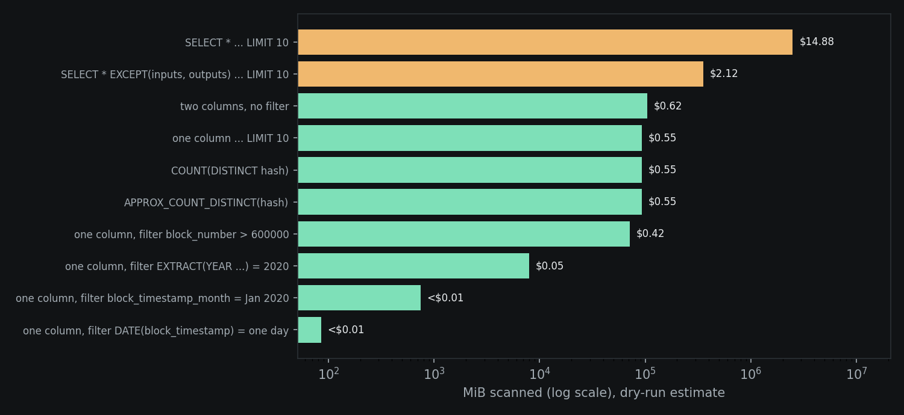

# BigQuery Cost Lab: what a query costs before you run it

Measurements of how common SQL habits change BigQuery on-demand cost, plus a small tested tool (`bqcost`) that lints a query and predicts the bytes it will scan. Everything below was measured in the BigQuery console on 2026-11-08, on public data and in a free sandbox project. No money was spent.

**Headline:** `SELECT * ... LIMIT 10` on the public Bitcoin transactions table would scan **2.38 TB (about $14.88)**. Selecting one column scans 90.73 GB ($0.55). Adding a one-day filter on the table's timestamp scans 85.5 MB (under a cent). The LIMIT never mattered.



## 1. Public table, dry-run estimates
Table: `bigquery-public-data.crypto_bitcoin.transactions`. Method: the console's "This query will process X when run" text for each query. These are dry runs; nothing was executed. Cost uses the on-demand list price of $6.25 per TiB (first 1 TiB per month free) from [Google's pricing page](https://cloud.google.com/bigquery/pricing).

| Query | Console estimate | On-demand cost |
|---|---|---|
| SELECT * ... LIMIT 10 | 2.38 TB | $14.88 |
| SELECT * EXCEPT(inputs, outputs) ... LIMIT 10 | 347.81 GB | $2.12 |
| two columns, no filter | 101.73 GB | $0.62 |
| one column ... LIMIT 10 | 90.73 GB | $0.55 |
| COUNT(DISTINCT hash) | 90.73 GB | $0.55 |
| APPROX_COUNT_DISTINCT(hash) | 90.73 GB | $0.55 |
| one column, filter block_number > 600000 | 69.59 GB | $0.42 |
| one column, filter EXTRACT(YEAR ...) = 2020 | 7.82 GB | $0.05 |
| one column, filter block_timestamp_month = Jan 2020 | 746.59 MB | under $0.01 |
| one column, filter DATE(block_timestamp) = one day | 85.5 MB | under $0.01 |
| COUNT(*) | 0 B | under $0.01 |

What this shows:
- **LIMIT is not a cost control.** Same bytes with or without it.
- **Two nested columns carry most of the table.** Dropping `inputs` and `outputs` from `SELECT *` cuts 2.38 TB to 347.81 GB.
- **APPROX_COUNT_DISTINCT scans the same bytes as COUNT(DISTINCT).** It saves compute, not scan cost.
- **COUNT(*) is free** because BigQuery answers it from table metadata.
- **A filter on `block_number` barely helps** (69.59 GB of 90.73 GB), while time filters cut the scan by 2 to 3 orders of magnitude. I did not determine why the `DATE(block_timestamp)` filter prunes so well: the table's DDL is hidden for public datasets, so I report the measurement without claiming a mechanism.

## 2. Partitioning and clustering, real runs
I copied January 2020 (9,612,337 rows, 9 columns) into three sandbox tables and ran the same queries on each. Bytes are "Bytes processed" and "Bytes billed" from each job's Job information tab (MB means MiB). Raw numbers: `measurements/lab_runs.json`.

| Query | No partition, no cluster | Clustered by block_number | Partitioned by day + clustered |
|---|---|---|---|
| SUM(fee) WHERE block_number BETWEEN 612600 AND 612700 | 220.01 MB (billed 221) | 18.96 MB (billed 19) | 6.67 MB (billed 10) |
| SUM(fee) WHERE DATE(block_timestamp) = '2020-01-15' | 220.01 MB (billed 221) | 11.54 MB (billed 12) | 7.61 MB (billed 10) |

- Clustering cut the range query by 11.6x and partition plus cluster by 33x in bytes processed. Billing floors at 10 MB per table, so the last two cells bill the same.
- Clustering also helped the date filter because `block_number` rises with time in this table. Clustering on an unrelated column would not do that; I did not test that case.
- One table, one month, two queries. These are demonstrations, not a benchmark.

## 3. Predicting bytes from column types
BigQuery documents per-type storage sizes (INT64 8 bytes, NUMERIC 16, BOOL 1, STRING 2 + UTF-8 length). `bqcost.estimate` multiplies the columns a query reads by the row count. I wrote down predictions before dry-running them:

| Query on the lab table | Predicted | Console |
|---|---|---|
| SELECT `hash` | 605.02 MiB | 605.02 MB |
| SELECT * | 1347.55 MiB | 1.32 GB (= 1347.5 MiB) |
| SUM(fee) WHERE block_number ... (fee NUMERIC + block_number INT64) | 220.01 MiB | 220.01 MB |

These are the checks `tests/test_estimate.py` locks in. The `hash` column is a 64-character string, so I used an average length of 64 (66 bytes per value).

## Use it
```
pip install -r requirements.txt
python -m pytest -q                 # 22 tests
python scripts/report.py            # rebuilds the table and chart from measurements/
PYTHONPATH=src python -m bqcost "SELECT * FROM tx_part_clust LIMIT 10"
```
Output for that query: three findings (SELECT *, LIMIT as cost control, no partition filter) and an estimate of 1348 MiB billed.

Lint rules (each tied to a measurement above): `BQ001` SELECT *, `BQ002` LIMIT with no filter or aggregate, `BQ003` no filter on a declared partition column, `BQ004` COUNT(DISTINCT) note (info only). SQL is parsed with [sqlglot](https://github.com/tobymao/sqlglot).

## Limits, stated plainly
- **Estimates are for column pruning only.** The estimator does not model partition or cluster pruning, so filtered queries get an upper bound. It handles single-table queries and simple joins by column name; it refuses unknown tables and types instead of guessing.
- **Console numbers are dry-run estimates or sandbox job stats, not an invoice.** The sandbox has no billing, so nothing here was charged. Costs are computed from bytes at the list price.
- **Unit assumption.** The console's GB/TB are binary (the 220.01 MB figure matches 24 bytes x 9,612,337 rows in MiB exactly), and I price them per TiB.
- **Public-table results are read-only measurements** of one table I did not build. Its layout is not visible to me.
- **Sandbox quirks found:** a table copy using default options came back with 0 rows because the sandbox's default 60-day partition expiry removed the old partitions; creating it with `OPTIONS(partition_expiration_days=3650)` kept the data. The free storage quota (about 10 GB) was also hit once on a larger copy.
- Prices change. Re-check the pricing page before relying on the dollar figures.

## Stack
Python, sqlglot, matplotlib, pytest, ruff, GitHub Actions. BigQuery console for measurement.
